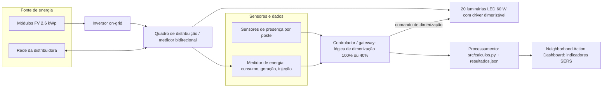

# 4. Diagrama da solução e indicadores

## Diagrama de blocos (renderiza no GitHub)

**Lógica de automação:** `se presença detectada ou horário de pico (18h-22h) → fluxo 100%; caso contrário → 40%`. O medidor registra consumo, geração FV e energia injetada; o processamento compara com a linha de base (A0) e publica os indicadores.

## Indicadores (todos derivados dos cálculos de `docs/02`)
| # | Indicador | Unidade | Fórmula | Valor estimado (A3) |
|---|---|---|---|---|
| I1 | Consumo da rede | kWh/mês | demanda − geração compensada | 0 (A2 sem FV: 262,8) |
| I2 | Economia energética | kWh/mês e % | E_A0 − E_rede | 1.241,0 kWh/mês (100%) |
| I3 | Redução de custos | R$/mês | custo_A0 − custo_alternativa (energia + operação) | R$ 1.078,43 |
| I4 | Participação de energia renovável | % | geração FV / demanda (limitada a 100%) | 100% (anual) |
| I5 | Emissões evitadas | kg CO₂e/ano | economia (kWh/ano) × FE | 367,8 (cenário alto: 1.882,4) |
| I6 | Tempo de funcionamento eficiente (dimerizado) | h/dia | 12 − horas em fluxo pleno | 8 h/dia |
| I7 | Payback simples | anos | capex / economia anual | 2,2 |

## Integração ao Neighborhood Action Dashboard
- **Componente pronto:** `dashboard/index.html` (abre direto no navegador; lê `dashboard/data.js`). Mostra KPIs, comparação entre alternativas, custo em 10 anos e série mensal demanda × geração.
- **Contrato de dados para o dashboard integrador:** `data/resultados.json` (chaves `alternativas.A0..A4`, `serie_mensal_A3`, `dimensionamento_fv`). Basta carregar o JSON e exibir os campos I1-I7.
- Para dados reais: substituir os valores simulados pelos do medidor, mantendo as mesmas chaves.
